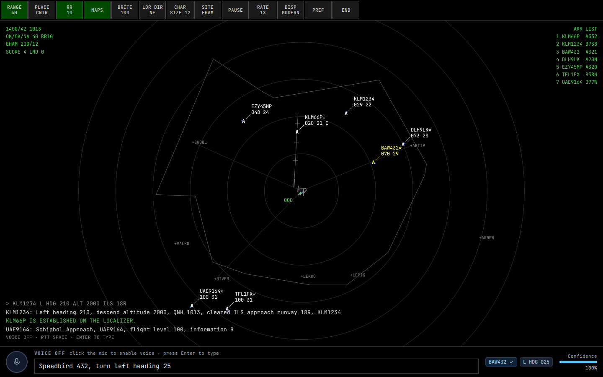

# Vectors

A free, open-source approach-control simulator that runs in your browser. You are **Schiphol Approach**: vector arrivals onto the ILS for runway 18R and hand departures over to the next controller, talking to pilots with **push-to-talk** or by typing. Pilots answer over the radio, and the game tells you when your phraseology isn't standard ICAO.

**Play:** https://omeiirr.github.io/vectors/


## How to play

1. Start with the **Tutorial**: five short lessons on headings, levels, speed, the ILS and handoffs.
2. Select an aircraft by clicking it on the scope or its strip on the left.
3. Give an instruction:
   - **Voice:** hold **Space** (or the mic button) and speak. The first time, the speech model downloads (about 40–200 MB, depending on your machine) and is cached after that.
   - **Keyboard:** press **Enter**, type, and press Enter again. With an aircraft selected you can leave out the callsign.
4. Listen to the readback. In Professional mode, about one readback in twenty has a wrong value. Catch it by saying "negative" and repeating the correct instruction.

Example transmissions:

```
KLM1234, turn left heading 210, descend altitude 2000, QNH 1013
Speedbird 432, reduce speed 180 knots
Easy 45 Mike Papa, cleared ILS approach runway 18R
KLM1234, contact Schiphol Tower 118.280
```

### Modes

|                     | Beginner                     | Professional                                    |
| ------------------- | ---------------------------- | ----------------------------------------------- |
| Separation and wake | warnings only                | 3 NM / 1000 ft and ICAO wake minima, penalised  |
| ILS intercept       | any angle                    | 30° or less, from at or below the glideslope    |
| Handoffs            | automatic                    | yours to make                                   |
| Readback errors     | off                          | about 5 % (adjustable)                          |
| Talking over pilots | allowed                      | blocks both transmissions                       |

There are two displays: **Modern** (the default) and **Realistic**, a STARS-style scope with 4-second radar updates.



## Privacy

Everything runs on your machine. Speech recognition (Whisper) and pilot voices (Piper) run in your browser; your browser downloads the model files from Hugging Face once. Your voice is never sent anywhere, unless you choose the "browser speech API" option in Settings, which in some browsers uses a cloud service and is labelled as such.

## Browser support

Desktop Chrome or Edge gives the best voice recognition (WebGPU). Firefox and Safari work, but use a smaller, slower speech model. Typing works everywhere, with or without voice.

## Develop

```sh
npm install
npm run dev          # local dev server
npm test             # unit, scenario and parser-corpus tests
npm run lint && npm run typecheck
npm run build        # static site in dist/
```

- `CLAUDE.md` is the project spec, `PROGRESS.md` the current status, and `DECISIONS.md` explains each design choice and data source.
- The parser corpus lives in `tests/phrases/` (650+ cases). It is generated by `scripts/gen-corpus.py`, plus hand-written cases in `manual.jsonl`.
- Airport data is generated by `scripts/build-eham.py`.

Pushes to `main` deploy to GitHub Pages once lint, typecheck and tests pass.

## License

MIT. Third-party data, models and voices keep their own licences, listed in [`THIRD_PARTY.md`](THIRD_PARTY.md).

Vectors is a game, not a training tool for real-world air traffic control.
