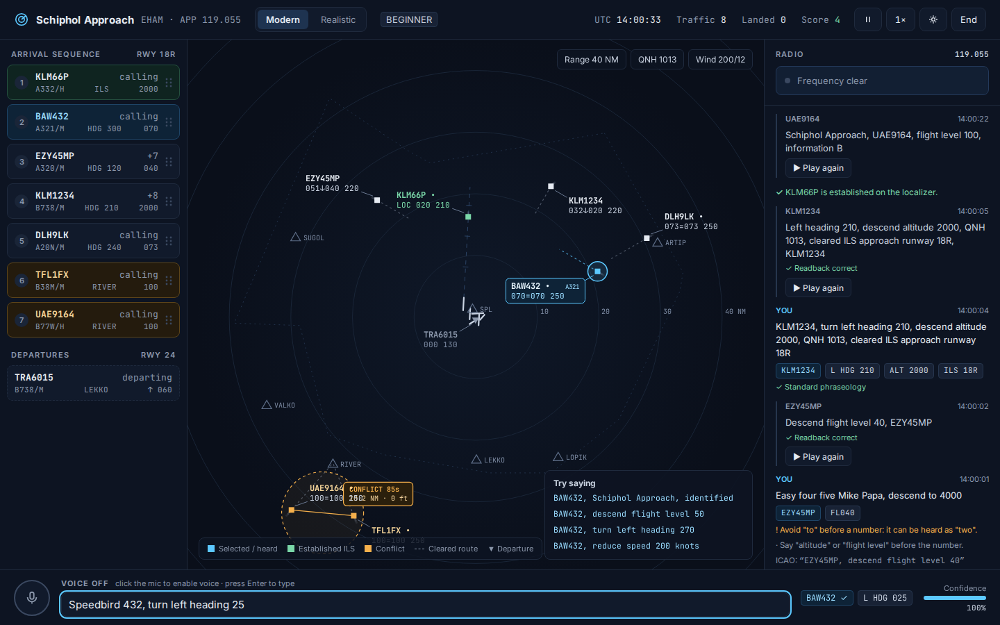
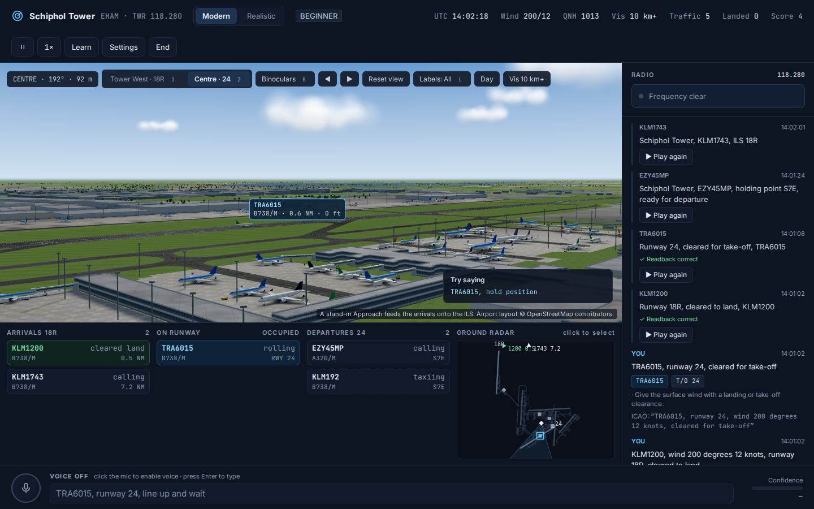
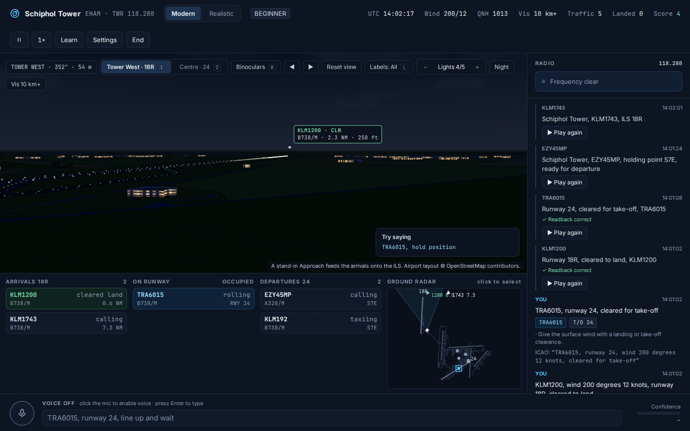

# Vectors

A free, open-source air traffic control simulator that runs in your browser. You are **Schiphol Approach**, vectoring arrivals onto the ILS for runway 18R on a radar scope, or **Schiphol Tower**, clearing aircraft to land and take off from a 3D tower view. You talk to pilots with **push-to-talk** or by typing. Pilots answer over the radio, and the game tells you when your phraseology isn't standard ICAO.

**Play:** https://omeiirr.github.io/vectors/



## How to play

1. Start with the **Tutorial**: five short lessons on headings, levels, speed, the ILS and handoffs. **Learn** (in the menu and the top bar) is a reference for the phonetic alphabet, how to say numbers, every command, and flight levels vs altitudes.
2. Select an aircraft by clicking it on the scope or its strip on the left.
3. Give an instruction:
   - **Voice:** hold **Space** (or the mic button) and speak. The first time, the speech model downloads (about 40–200 MB, depending on your machine) and is cached after that.
   - **Keyboard:** press **Enter**, type, and press Enter again. With an aircraft selected you can leave out the callsign.
4. Listen to the readback. In Professional mode, about one readback in twenty has a wrong value. Catch it by saying "negative" and repeating the correct instruction.

Example transmissions:

```
KLM1234, turn left heading 210, descend altitude 2000, QNH 1013
Speedbird 432, reduce speed 180 knots
Easy 45 Mike Papa, cleared ILS approach runway 18R
KLM1234, contact Schiphol Tower 118.280
```

### Modes

|                     | Beginner                     | Professional                                    |
| ------------------- | ---------------------------- | ----------------------------------------------- |
| Separation and wake | warnings only                | 3 NM / 1000 ft and ICAO wake minima, penalised  |
| ILS intercept       | any angle                    | 30° or less, from at or below the glideslope    |
| Handoffs            | automatic                    | yours to make                                   |
| Readback errors     | off                          | about 5 % (adjustable)                          |
| Talking over pilots | allowed                      | blocks both transmissions                       |

There are two displays: **Modern** (the default) and **Realistic**, a STARS-style scope with 4-second radar updates.


## Tower mode



As Schiphol Tower you run runway 18R for landings and runway 24 for departures. A stand-in Approach controller feeds the arrivals onto the final. Your job:

- Clear arrivals to land, or tell them to continue the approach or go around.
- Tell them where to vacate, and hand them to Ground.
- Line departures up, clear them for take-off, and hand them to Departure.

Conditional line-ups ("behind the departing A320, runway 24, line up and wait, behind") and traffic information work too.

```
KLM1234, wind 200 degrees 12 knots, runway 18R, cleared to land
KLM1234, vacate left via V3, contact Ground 121.560
Transavia 6015, runway 24, line up and wait
Transavia 6015, runway 24, wind 200 degrees 12 knots, cleared for take-off
```

You work from either of the two real cabs: **Tower West** for 18R (key `1`) or the **central tower** for 24 (key `2`).

- **Look around:** turn with the left and right arrow keys, look up and down with the up and down arrows (or drag the view). Hold `B` for binoculars, which follow the selected aircraft. `L` switches the aircraft labels.
- **Light and weather:** switch between day, dusk and night, and lower the visibility for fog.
- **On the desk:** strip bays (Arrivals, On runway, Departures) and a ground radar.
- **The scenery:** the airport, the land around it and the buildings are drawn from OpenStreetMap. Parked aircraft fill the stands, and scenery traffic taxis between the stands and the runways.
- **Sound:** engines, touchdowns and the cab itself are synthesised in the browser (no sound files). The radar room has its own sounds: a conflict chime and the landline from Tower. One volume control in Settings.
- **Getting started:** four short lessons in the Tower menu group teach the basics. Free play and four Pro scenarios follow, including fog at dusk.

The 3D view downloads about 2 MB of airport data the first time you open it. The radar game doesn't need it.



## Privacy

Everything runs on your machine. Speech recognition (Whisper) and pilot voices (Piper) run in your browser; your browser downloads the model files from Hugging Face once. Your voice is never sent anywhere, unless you choose the "browser speech API" option in Settings, which in some browsers uses a cloud service and is labelled as such.

## Browser support

Desktop Chrome or Edge gives the best voice recognition (WebGPU). Firefox and Safari work, but use a smaller, slower speech model. Typing works everywhere, with or without voice.

## Develop

```sh
npm install
npm run dev          # local dev server
npm test             # unit, scenario and parser-corpus tests
npm run lint && npm run typecheck
npm run build        # static site in dist/
```

- `CLAUDE.md` is the project spec, `PROGRESS.md` the current status, and `DECISIONS.md` explains each design choice and data source.
- The parser corpus lives in `tests/phrases/` (700+ cases). It is generated by `scripts/gen-corpus.py`, plus hand-written cases in `manual.jsonl`.
- Airport data is generated by `scripts/build-eham.py`. The tower view's data in `public/tower/` (ground, land, buildings, stands, textures) comes from the `scripts/build-tower-*.py` scripts.

Pushes to `main` deploy to GitHub Pages once lint, typecheck and tests pass.

## License

MIT. Third-party data, models and voices keep their own licences, listed in [`THIRD_PARTY.md`](THIRD_PARTY.md).

Vectors is a game, not a training tool for real-world air traffic control.
